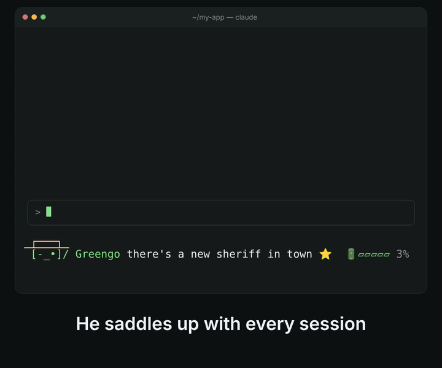

<div align="center">

<table><tr><td align="left">
<pre><ins> ┌───┐ </ins>
┌[≖_≖]┘~◯ Greengo rustlin' up app.ts 🔨</pre>
</td></tr></table>

# 🤠 Greengo

**A little green cowboy robot who rides along while you code with Claude Code.**

He swings his lasso while Claude works, narrates every step in a frontier drawl,
tips his boater when the job's done, and naps when things go quiet.

[](https://github.com/vedjuk/greengo/actions/workflows/ci.yml)


</div>

<p align="center">
  
</p>

## What he does

Greengo lives in Claude Code's status line (and in VS Code and the Claude desktop app, which don't show status lines). He watches what Claude is doing and reacts:

<pre><ins> ┌───┐ </ins>
 [¬‿¬]/ Greengo badges? we don't need no stinkin' badges ⭐         ← session starts
┌[≖_≖]┘~◯ Greengo readin' auth.ts 📜                                ← Claude reads a file
└[ò_ó]┐~○ Greengo high noon for the tests 🕛 ♞  ♞                   ← tests, with 2 subagents out ridin'
 [¬_¬]╾~ Greengo call it, friendo 🪙                                ← Claude needs your OK
 [×_×] Greengo deserve's got nothin' to do with it ⚠️               ← a tool failed (in red)
 [-‿-]/ Greengo ridin' off into the sunset 🌅                       ← done, and he tips his hat
 [-_-] Greengo Shane… come back… 💤                                 ← napping after 90 quiet seconds</pre>

- **Narrates Claude's work** with 140+ lines: nods to Tombstone, The Good, the Bad and the Ugly, Butch Cassidy, High Noon, No Country for Old Men and more, plus plenty of cowpoke coding talk ("testin' the herd 🧪", "signin' the ledger ✍️", "catchin' the 3:10 to origin 🚂").
- **Has range.** Stone cold `[¬_¬]╾~` with a cigarillo, gunslinger squint `[≖_≖]`, rough `[ò_ó]`, smug `[¬‿¬]`, and only now and then a cute grin `[^ᴗ^]`. After 11pm he gets weary: `[=_=]`.
- **Wears a straw boater** (think Joe LeFors, not Woody) and tips it when a job's done or when you say please.
- **Saddles a horse ♞** for every subagent Claude sends out.
- **Battery meter** 🔋▰▰▱▱▱ shows how full Claude's context window is (terminal only).
- **Talks in his sleep** when you leave him alone, and blinks while he stands guard.
- **Stays out of the way.** His hooks run in the background, add nothing to Claude's context, and send nothing anywhere.

## Requirements

- **macOS** (Linux works too; Windows isn't supported yet)
- **[Claude Code](https://code.claude.com/docs/en/setup)**, a recent version (`claude update`)
- **python3**, only for the installer (macOS offers to install it with the developer tools)
- **VS Code** (optional), for the status bar and panel version
- **Claude desktop app** (optional), for Greengo above the prompt in the Code tab

## Install

```bash
git clone https://github.com/vedjuk/greengo.git
cd greengo
./install.sh
```

The installer:

1. copies Greengo to `~/.claude/greengo/`
2. adds his hooks and status line to `~/.claude/settings.json`, keeping everything else and saving a backup first
3. adds a `/greengo` command to Claude Code
4. installs the VS Code extension, if it finds VS Code
5. sets up the Claude desktop app mod, which puts Greengo above the prompt in the Code tab

Then start a new session with `claude` in a terminal, or in the desktop app's Code tab, and Greengo rides in. If you use VS Code, reload it once (`Cmd+Shift+P` → **Developer: Reload Window**).

## In VS Code

VS Code's Claude Code chat panel doesn't show terminal status lines, so Greengo comes with a small VS Code extension. He follows whichever Claude session was active most recently, chat panel or terminal.

| Status bar (compact) | Greengo panel (the full look) |
|---|---|
|  | Boater, colors and animation, in a tab next to the Terminal. Move it anywhere: right-click the **Greengo** tab → **Move To**. |

More in [docs/vscode-extension.md](docs/vscode-extension.md).

## In the Claude desktop app

The desktop app's Code tab doesn't show terminal status lines either, so Greengo comes with a small Claude Code mod that draws him, boater and all, in a band right above the prompt. The installer sets it up; start a new Code session to see him. More in [docs/desktop-app.md](docs/desktop-app.md).

## Usage

Type these in Claude Code:

| Command | What it does |
|---|---|
| `/greengo stats` | Rides together and chores wrangled |
| `/greengo name Tex` | Renames him |
| `/greengo color cyan` | green (default), cyan, yellow, red, blue, magenta, white, gray, orange, pink |
| `/greengo hat off` / `/greengo hat on` | Bareheaded takes one line instead of two |
| `/greengo hide` / `/greengo show` | Sends him off, brings him back |

## Make him your own

All of Greengo's personality lives in one readable bash script, `~/.claude/greengo/greengo.sh`. Add a line to any state, invent new faces, change when he naps. Your changes show up within a second, in the terminal, VS Code and the desktop app alike. See [docs/customizing.md](docs/customizing.md).

## Uninstall

```bash
~/.claude/greengo/uninstall.sh
```

This removes his hooks, status line, `/greengo` command, VS Code extension, desktop mod and files, and puts back any status line you had before.

## Documentation

| | |
|---|---|
| [How it works](docs/how-it-works.md) | Hooks, state files, the status line and the extension |
| [Moods and faces](docs/moods-and-faces.md) | Every mood, what triggers it, and the faces he pulls |
| [Customizing](docs/customizing.md) | New lines, new faces, colors, timings |
| [VS Code extension](docs/vscode-extension.md) | Status bar, panel, settings, building the `.vsix` |
| [Claude desktop app](docs/desktop-app.md) | The band above the prompt, and developing the mod |
| [Troubleshooting](docs/troubleshooting.md) | When Greengo doesn't show up |

## Contributing

New lines, new faces and bug fixes are all welcome. See [CONTRIBUTING.md](CONTRIBUTING.md). Run `bash tests/smoke.sh` before sending a pull request.

## Credits

Inspired by [pixel-pet](https://github.com/lakmadev/pixel-pet) by lakmadev. The movie lines are short nods to the classic Westerns they come from.

## License

[MIT](LICENSE)

Greengo is a fan project and isn't affiliated with or endorsed by Anthropic. Claude and Claude Code are trademarks of Anthropic.
