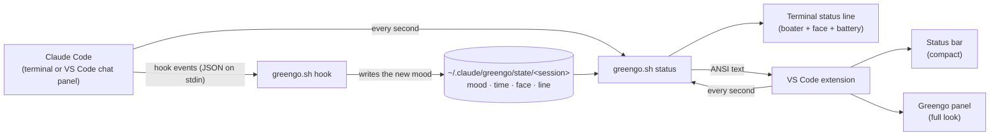

# How Greengo works

Greengo is built entirely on two standard Claude Code features, [hooks](https://code.claude.com/docs/en/hooks) and the [custom status line](https://code.claude.com/docs/en/statusline), plus a small VS Code extension. There's no daemon and no network access, just one bash script and a few tiny files.



## 1. Hooks turn events into moods

Claude Code runs `greengo.sh hook` on these events and pipes the event's JSON to it:

| Event | Greengo's mood |
|---|---|
| `SessionStart` | `boot`: says howdy |
| `UserPromptSubmit` | `listen` (or `blush` if you said please or thanks) |
| `PreToolUse` | `work`: a line chosen for the tool (Read, Edit, Bash with tests, git push, …) |
| `PostToolUseFailure`, `StopFailure` | `error` |
| `Notification` | `wait`: Claude needs your OK, or it's your turn |
| `SubagentStart` / `SubagentStop` | one more / one fewer horse ♞ |
| `Stop` | `happy`: job's done, hat tip |
| `PreCompact` | `work`: packin' the saddlebags |
| `SessionEnd` | cleans up that session's state |

The hook picks a random line and a random face for the mood, then writes one line to `~/.claude/greengo/state/<session_id>`:

```
work|1792012345|≖_≖|it's high noon for app.ts 🕛
```

All hooks are registered with `"async": true`, so they run in the background and never slow Claude down. They print nothing, so they never add anything to Claude's context.

Hooks run in every Claude Code surface, including the VS Code chat panel, so Greengo's mood stays current wherever you work.

## 2. The status line draws him

Claude Code runs `greengo.sh status` for its status line. The settings ask for a refresh every second (`"refreshInterval": 1`), which is what makes him animate. Each run:

1. reads the session's state file
2. works out time-based changes: settle down after a while, nap after 90 quiet seconds, talk in his sleep, blink, weary faces after 11pm
3. picks the animation frame from the clock (lasso swing, hat tip, cigarillo smoke)
4. prints two lines with terminal colors: the boater (crown `┌───┐` over an underlined brim) and his face line, plus a battery meter from the context window figure Claude Code passes in

## 3. The VS Code extension borrows the same drawing

VS Code's chat panel doesn't show terminal status lines. The extension fills that gap without duplicating any of Greengo's personality:

- Once a second it finds the most recently updated state file, so it follows the latest active session.
- It runs `greengo.sh status` for that session, with `GG_NO_BATTERY=1`, since only the terminal knows the context window size.
- It converts the terminal colors to VS Code theme colors and shows the result in the status bar (the face line only, as plain text) and in the Greengo panel (everything, as styled HTML).

So any line or face you add to `greengo.sh` shows up in the terminal and in VS Code at the same time.

## Files

| Path | What it is |
|---|---|
| `~/.claude/greengo/greengo.sh` | The whole personality: hooks, drawing, commands |
| `~/.claude/greengo/config` | Name, color, hat on or off, hidden or shown |
| `~/.claude/greengo/state/<session>` | Current mood for each session |
| `~/.claude/greengo/state/<session>.horses` | How many subagents are out |
| `~/.claude/greengo/sessions`, `chores` | Lifetime counters for `/greengo stats` |
| `~/.claude/skills/greengo/SKILL.md` | The `/greengo` command |
| `~/.claude/settings.json` | Gets Greengo's `hooks` and `statusLine` entries |
| `~/.claude/settings.json.greengo-backup-*` | Backups made by the installer and uninstaller |

State files older than a day are tidied up automatically.

## Why bash?

Greengo has to run on a stock Mac with nothing extra installed, and the status line runs every second. macOS ships bash 3.2, so the script avoids anything newer, parses JSON with `grep` and `sed` instead of needing `jq`, and keeps every run to a few milliseconds.
