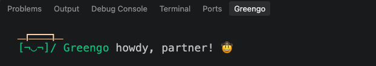

# Greengo in VS Code

Claude Code's chat panel in VS Code doesn't display terminal status lines. The Greengo extension shows him in VS Code itself, in two places:

| | |
|---|---|
| **Status bar** | A compact one-liner at the bottom right: `[¬_¬]╾~ Greengo call it, friendo 🪙`. It turns red when something breaks. Click it to open the panel. |
| **Greengo panel** | The full look: boater, colors and the once-a-second animation. |

He follows whichever Claude Code session was active most recently, so he works with the chat panel, with `claude` in the terminal, or both. The battery meter is the only thing missing, because the chat panel doesn't share how full the context window is.



## Installing

`./install.sh` installs the extension for you, using VS Code's `code` command. Afterwards, reload VS Code once: `Cmd+Shift+P` → **Developer: Reload Window**.

If the installer can't find VS Code (for example, if it isn't in `/Applications`), install it by hand:

1. Open the Extensions view (`Cmd+Shift+X`).
2. Click the `…` menu at the top → **Install from VSIX…**
3. Pick `~/.claude/greengo/greengo.vsix`, or `greengo.vsix` in the repo.

## Moving the panel

The panel starts as a **Greengo** tab next to the Terminal. To put him somewhere else:

- **Right-click the Greengo tab** → **Move To** → **Secondary Side Bar** or **Primary Side Bar**, or
- **`Cmd+Shift+P` → View: Move View** → **Greengo** → pick a spot. Choosing **Explorer** makes him a small foldable section under your files, next to Outline and Timeline.
- Or drag the **Greengo** tab onto a sidebar.

VS Code remembers where you put him.

> **Greengo right beside the chat:** VS Code doesn't allow panels inside editor tabs. Set Claude Code's **Preferred Location** setting to **sidebar**, then move Greengo to the **Secondary Side Bar**. He'll sit right under the chat.

## Settings and commands

| Setting | Default | |
|---|---|---|
| `greengo.statusBar` | `true` | Show the compact Greengo in the status bar |
| `greengo.statusBarMaxLength` | `60` | Longest status bar text before it's trimmed with … |
| `greengo.panelFontSize` | `18` | Font size in the panel, in pixels |

| Command (`Cmd+Shift+P`) | |
|---|---|
| **Greengo: Show panel** | Opens and focuses the panel |
| **Greengo: Toggle status bar** | Turns the status bar version on or off |

`/greengo hide` also hides him in VS Code, and `/greengo color …` and `/greengo name …` apply everywhere.

## Developing the extension

The extension is plain JavaScript with no build step and no dependencies: [`vscode/extension.js`](../vscode/extension.js).

```bash
# Test it without VS Code (uses a fake VS Code API and the real greengo.sh)
node tests/extension.test.js

# Build greengo.vsix in the repo root (downloads vsce with npx)
cd vscode && npm run package
```

To try changes live, open the `vscode` folder in VS Code and press `F5`. That starts a second VS Code window with your version of the extension loaded.

Remember to rebuild and commit `greengo.vsix` when you change the extension, since `install.sh` installs that file.
